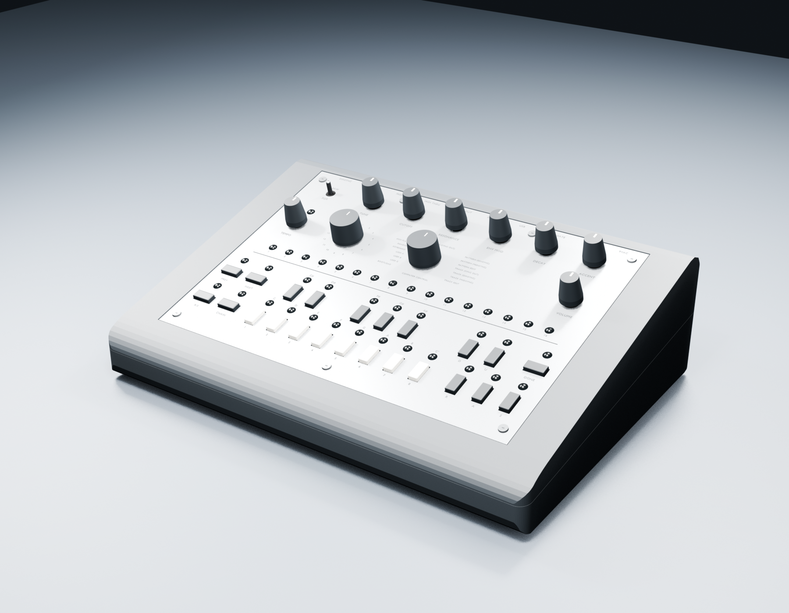

# x0xb0x hardware: KiCad and Blender

Private working repository for the x0xb0x Eagle-to-KiCad conversion and reconstructed enclosure assembly. Original design: **Copyright (c) Limor Fried & Adafruit Industries**. x0xb0x is an Adafruit trademark.

## Open the current projects

- [Mainboard — KiCad working revision 11](kicad-working/mainboard/mainboard.kicad_pro)
- [I/O board — KiCad working revision 11](kicad-working/ioboard/ioboard.kicad_pro)
- [Complete assembly — Blender revision 11](kicad-working/visualization/blender-case-revision-11/x0xb0x-populated-with-case.blend)
- [KiCad notes](kicad-working/README.md) and [Blender views and limitations](kicad-working/visualization/blender-case-revision-11/README.md)

Keep each complete project folder together: symbols, footprints and STEP models use project-relative paths. The Blender file embeds the populated boards and can be opened without the original workspace or external board exports. It was saved with Blender 5.0.0. The current KiCad projects were checked using KiCad 10.0.7.

See [opening and verification instructions](docs/OPENING.md) for a fresh download.

## What is included

- Both editable KiCad schematics and routed PCBs, project-local libraries and all 491 fitted component models.
- The original four Eagle files, byte-for-byte preserved under [original-eagle](original-eagle/).
- The corrected Blender enclosure, original panel DXFs, model generators, reference sources, attribution and verification reports.
- Complete PCB-mounted LED models at all 40 positions. Their lenses pass through the front panel; the earlier duplicate lens objects were removed.
- All 23 button caps attached to their PCB switches in the exploded view, with their assembled positions retained.
- The detailed rear jacks and photo-qualified bent-back regulator/heatsink arrangement.
- Open rear socket mouths in the complete assembly: five obsolete solid display disks removed, and through-bores added to the three audio jack nuts and washers.

Blender views: **frame 1** assembled, **frame 80** exploded, **frame 120** control-side inspection, **frame 160** wiring study. The caps are intentionally hidden in the two inspection views.

## Validation and known limits

Blender revision 11 places the eleven existing rear legends on the plate. Their glyphs previously floated more than 1.24 mm above it and cast detached shadows; they now retain a 0.01 mm rendering gap. Their typography, ink material and in-plane positions are preserved, along with all connector, nut, washer, PCB and enclosure geometry. The text remains presentation artwork; the original rear DXF contains manufacturing annotations rather than these control legends. See the [rear seating and legend review](docs/rear-seating-and-legends.json).

The measured seating review also records unresolved nominal intersections: the three audio body shoulders extend 0.508 mm into the panel from its inner plane, and the power/USB bodies overlap the rectangular lower edges by approximately 0.081 mm. The case setback, historical body/terminal registration and fitted variants remain uncertain. These findings do not justify a universal board translation or modifying original cutouts. The legend correction preserves these positions and does not establish mechanical clearance. Detailed [scene measurements](kicad-working/validation/rear-seating-review/scene-audit/README.md) and [source limits](kicad-working/validation/rear-seating-review/source-audit/README.md) remain explicit.

Blender revision 10 refines the three NYS216 mounting nuts from the retained official DXF, PDF and product photograph: 15 mm wrench flats, a circular rear flange and a rounded front treatment. Only these three presentation meshes change. The washer geometry, native connectors, all other components, case, materials, positions and animation remain as in revision 9. The source dimensions and illustrative details are separated in the [hardware refinement review](kicad-working/validation/nys216-hardware-quality/README.md). The front rounding remains a visual reconstruction; undimensioned rear-face features are omitted. See the [nut refinement report](docs/nys216-hardware-refinement.json).

Blender revision 9 corrects rear socket occlusion in the presentation geometry. The installed native connector models already had open entrances; five separate display disks and six solid audio hardware pieces covered them. The correction preserves all 491 native component assemblies, the case and panel cutouts, component positions, materials and animation. Independent checks inspect all 11 rear ports using the evaluated assembly geometry, including the DIN contact mouths and the passages around the power pin and USB tongue. See the [rear opening review](kicad-working/validation/rear-openings-review/scene-audit/README.md) and [source model review](kicad-working/validation/rear-openings-review/source-audit/README.md). Earlier preservation checks did not test these openings.

The audio nut bores use an illustrative 9.6 mm clearance around the installed 9.525 mm nose; washer bores use the retained 11.3 mm drawing dimension. The manufacturer's DXF and product photo confirm the six-flat SW15 nut, as recorded in the [hardware source review](kicad-working/validation/rear-openings-review/source-audit/NYS216-HARDWARE.md). The older 3/8-32 UNEF source and later M11 drawing describe different threads, so the exterior hardware depiction does not establish interchangeability or physical fit. These updates change only Blender; the KiCad revision-11 projects and their electrical findings remain unchanged.

KiCad revision 11 updates 24 historical 2SC536F transistor illustrations and both ceramic resonators. Its saved model integration passed 5,200 checks and source/native integration review passed 4,041 checks; the companion Blender revision 8 passed 12,819 preservation checks. The transistor dimensions are typical values, and the historical NP package choice remains a documented inference from the BOM and original photo. Resonator maximum envelopes and complete leads are preserved. Both schematics passed ERC with zero errors and warnings under the recorded project rules. Existing PCB connection gaps remain at mainboard IC9.8/GND, mainboard S22.1/+5V and I/O MIXOUT0/GND; recorded DRC and schematic-parity warnings also remain. The 3D updates did not alter the circuit, copper routing or footprint placement.

The LED height uses the BOM's named STD240B 0.24-inch spacer. An older assembly table says 0.22 inch; the discrepancy is documented. Exact spacer molding, button retention/travel, historical vendor variations, omitted terminals, reconstructed enclosure tolerances and the wiring study remain qualified. These files do not establish fabrication or physical assembly readiness.

Four reusable checks are included:

- `python3 scripts/verify_project.py` checks file hashes, the 257 current KiCad project files, original Eagle sources and saved Blender scene.
- `python3 scripts/verify_kicad_dependencies.py` checks that symbols, footprints and all 491 placed models resolve inside the checkout, without global KiCad libraries. Both Python checks accept `--root PATH` and require Python 3.9 or later.
- `scripts/verify_blender_scene.py` runs inside native Blender and checks embedded components, complete LED assemblies, cap attachment across views and external file dependencies. See the opening instructions for the command, including the required failure exit-code option.
- `scripts/verify_rear_openings.py` runs inside native Blender and checks the actual rear mating passages for scene geometry that covers them. It accounts for intentional contacts and recessed inserts.

The initial revision-10 fresh download passed native KiCad ERC, model exports and 106 Blender portability checks; [historical fresh-download verification](docs/fresh-clone-verification.json) pins that source commit and scene hash. Current revision-11 ERC/DRC, geometry and assembly-preservation checks are recorded in [working validation](kicad-working/validation/working-validation-summary-revision-11.json). Both schematics remain ERC-clean, and DRC findings retain their previous types, severities and descriptions.

These checks do not establish physical fit. The historical native audit/model-generation scripts retain source paths and may require macOS applications, earlier source baselines or other tools; their recorded results are preserved as evidence.

Key reports: [working validation](kicad-working/validation/working-validation-summary-revision-11.json), [front controls](kicad-working/validation/models-review-10/front-controls-review/final-front-control-assembly-review.md), [saved-scene verification](kicad-working/visualization/blender-case-revision-11/verification/final-saved-scene-audit.json), [rear opening correction](docs/rear-opening-correction.json), [hardware refinement](docs/nys216-hardware-refinement.json), [rear seating and legends](docs/rear-seating-and-legends.json).

Delivery ZIPs, earlier experimental Blender scenes, temporary native probes, local application state and redundant board GLB exports are excluded. The revision-7 through revision-10 scenes are retained as comparison baselines for the subsequent updates. The native GLB exports can be regenerated from the KiCad projects with `kicad-working/validation/models-review-11/export_quality_boards.py`; they are already embedded in the saved Blender scene.

## Sources and licensing

See [LICENSE.md](LICENSE.md) for asset-level attribution. Original documentation: [downloads](https://www.ladyada.net/make/x0xb0x/download.html), [parts list](https://www.ladyada.net/make/x0xb0x/fab/parts.html), [sequencer assembly](https://www.ladyada.net/wiki/x0x/sequencerfabrication). The original Eagle conversion used the existing cozycactus KiCad fork at commit `ac8691a64afa0a78d04f0073e82896bcdec82657`; no KiCad source change was required.

This repository starts with a snapshot of the current validated working files. Earlier local work is represented by the included provenance and reports, rather than an invented Git history.
