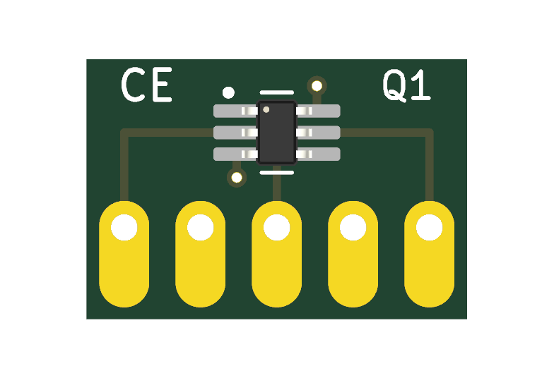
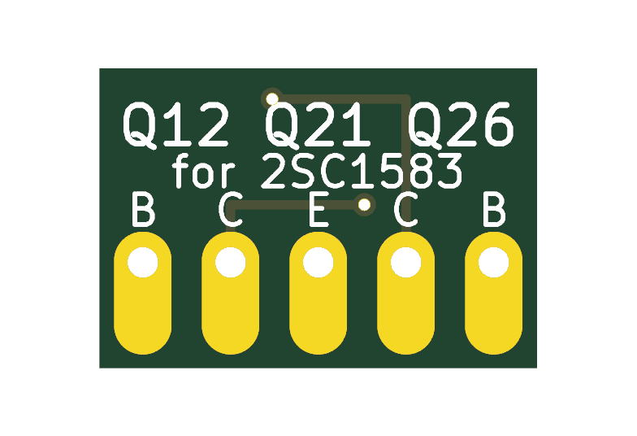

# SSIP5 adapters for the rare dual transistors

Small boards that replace the 2SC1583 at Q12, Q21 and Q26 and the 2SC2291 at Q22, which can now only be had as old stock. They use parts you can still buy and fit the mainboard's existing holes. The mainboard, its Eagle sources, copper and placement are unchanged.

**Status: designed and checked in KiCad and in simulation. Nothing has been ordered, built or measured.** Every electrical figure below is a model value.

| Site | Board | Chip | Why this chip |
|---|---|---|---|
| Q12 | CE | BCM847BS | Vbe matching is what counts here; the datasheet promises 2 mV at 2 mA |
| Q21 | CE | **BC847CDW1T1G** | The one position where gain matters; this part has the higher gain |
| Q26 | CE | BCM847BS | Same reason as Q12; a Vbe offset is trimmed out with TM4 |
| Q22 | CB | BCM847BS | The model shows no effect from this pair |

To order: both boards at the fab's minimum (5 each covers the build with spares), 5 BCM847BS, 3 BC847CDW1T1G, and 0.6 mm tinned copper wire. Mark the Q21 adapter so it doesn't get mixed up, because both chips go on the same board.




## Why these parts

The [VCF study](../../validation/vcf-simulation/README.md) found that Q21's gain sets how strong the resonance is, so the replacement's gain was the question to test. Q21 runs at about 260 µA per side (5.8 V across R110, 22 kΩ), and its base current loads the top of the ladder.

BCM847 has a matching guarantee but its gain sits at the low end of the original's range. BC847C has no matching guarantee, but the model shows Q21 tolerates a loose match.

Resonance Q at full Resonance, at Cutoff 0, 50 and 100 %, and how far the loop stays below self-oscillation at the same settings:

| In Q12, Q21, Q22 | Q | Margin, dB |
|---|---|---|
| Original, hFE 400 (the study's reference) | 2.5, 5.9, 26.1 | −6.51, −2.84, −0.64 |
| Original, hFE 250 and 800 (its datasheet limits) | 1.9, 4.3, 16.7 and 3.4, 8.6, 46.5 | −8.32, −3.82, −0.99 and −4.80, −1.96, −0.33 |
| BCM847 in all three, typical | 2.0, 4.6, 18.1 | −7.71, −3.52, −0.92 |
| BCM847 in all three, hFE 200 and 450 at 2 mA | 1.6, 3.5, 13.0 and 2.6, 6.2, 27.1 | −9.43, −4.48, −1.29 and −6.18, −2.70, −0.63 |
| **BC847C in Q21, BCM847 in Q12 and Q22 (chosen)** | **2.7, 6.5, 28.3** | **−5.90, −2.56, −0.60** |
| The same, BC847C hFE 420 and 800 at 2 mA | 2.5, 5.8, 24.1 and 3.3, 8.1, 36.2 | −6.51, −2.87, −0.70 and −4.97, −2.09, −0.44 |
| SSM2212 in Q21, BCM847 in Q12 and Q22 | 3.0, 6.9, 29.6 | −5.46, −2.41, −0.55 |

Which hFE grade Roland fitted is not established, so "closest to hFE 400" is a choice of reference, not a claim about the original sound. A builder who prefers less resonance can put BCM847BS in Q21 too.

Other results from the same runs (`results/substitutes.json`):

- **Peak frequency:** moves by at most 0.05 octave with BCM847 or BC847C.
- **Which position matters:** BCM847 in Q12 alone or Q22 alone changes almost nothing (top Q 25.1 and 26.1 against 26.1). In Q21 alone it gives the whole drop.
- **Matching in the chosen build:** at Q21, an hFE ratio of 0.9, 0.8 and 0.7 gives a top Q of 26.1, 25.1 and 22.5; a Vbe offset of 10 and 30 mV gives 27.2 and 22.5. At Q12, 2 mV changes nothing and 10 mV shifts the peak by 0.06 octave.
- **Output noise:** 1.2 to 1.7 µV at the VCF tap across every case, with no meaningful difference between the parts. This is white noise only (see the limits below).
- **Reverse base-emitter voltage:** none in the note pattern tested, at any of the pairs.

Q26, the VCO's exponential converter (`results/substitutes_vco.json`), after trimming TM4 and TM5 as on a real unit:

| Q26 | C2 before the trim | TM4 | Largest error, 32.7 to 523 Hz |
|---|---|---|---|
| Original, hFE 400 | 65.42 Hz | 0.527 | 0.9 cents |
| BCM847, typical | 65.73 Hz | 0.531 | 2.0 cents |
| BCM847, 2 mV offset either way | 60.86, 71.02 Hz | 0.452, 0.606 | 2.0 cents |
| BCM847, 10 mV offset either way | 44.71, 96.68 Hz | 0.126, 0.854 | 1.6 cents |

So the trim absorbs a 10 mV offset, five times the datasheet limit.

**SSM2212** was checked and left out. It models well and is the better device on paper: one die, 0.9 nV/√Hz, hFE about 580 down to 1 µA, and an offset of 200 µV maximum that changes by at most 70 µV from 1 µA to 1 mA. But it costs about $8.60 each at LCSC (undated listing), needs an SOIC-8 board, and has 20 to 30 pF collector-base capacitance against 2.5 pF. If a built unit's VCO proves to drift with the BCM847, Q26 is where to try it first, on a new board.

## Why it stands on edge, and why two boards

- **On edge:** a flat board carrying the chip beside the pin row needs about 3.1 mm of overhang. Q12 and Q22 offer only 2.8 to 3.1 mm to tall neighbours. Standing up, the board fits every site.
- **Two boards:** one board with the common-emitter wiring on one face and common-base on the other was considered. The collectors need jumps through to the other layer on both, so the two would share routing, the board would grow to about 10 mm tall, and a chip could go on the wrong face. Each design costs little at this size.

## Mechanics

Board 11.4 × 7.8 × 1.6 mm. The original body is 8.1 × 3.6 × 5.6 mm maximum, on a row 9.1 mm long, so the board's length just covers the row.

```
   side view, along the pin row

      |  |<- 1.6 mm board
   [] |  |      chip, on the wire side
      |  |      top 9.8 mm above the mainboard
      |  |
     ||  |      wire lap-soldered to the long pad
     ||__|      bottom edge 2 mm above the mainboard
     ||
 ====||====     mainboard, 1.0 mm hole
     ||
```

The wires stay on the row's centre line and the board sits behind them, so the board body leans to one side. Either rotation is electrically correct, since turning it round only swaps the two halves. It does matter for fit, though: the wrong way touches a neighbour at every site.

| Site | Board body leans toward | Smallest gap | Nearest |
|---|---|---|---|
| Q12 | C18 | 1.15 mm | C18 |
| Q21 | R110, R111 | 0.57 mm | R113 |
| Q22 | Q23 | 0.75 mm | C24 |
| Q26 | R100A | 0.81 mm | R103 |

These come from `fit_check.py`, which measures against the placed 3D models. Those bodies are illustrations of nominal size, so a thicker film capacitor will reduce the gap. This is not a physical-fit qualification.

## Assembly

Fit these before the tall parts around them, because the lap joints need room for an iron.

1. **Chip:** solder it on the front, with pin 1 at the silkscreen dot. Use flux and check for bridges under magnification.
2. **Wires:** cut five 15 mm lengths of 0.6 mm wire and straighten them. Stand them loose in the site's mainboard holes.
3. **Spacer:** put a 2 mm spacer on the mainboard, such as folded card, and rest the adapter's bottom edge on it, with the front against the wires and the body leaning as in the table.
4. **Lap joints:** solder each wire along its long pad. For more strength, bend the top of the wire through the hook hole first.
5. **Test:** lift the adapter out with its wires and measure it, as below.
6. **Fit:** put it back on the spacer, solder from under the mainboard, trim, and remove the spacer.

## Measuring a finished adapter

You need a 9 V supply, a multimeter with 10 MΩ input, and clip leads. Row pins are numbered 1 to 5; on the CE board 1 and 5 are bases, 2 and 4 collectors, 3 the emitters.

**hFE of one half (CE board).** Connect pin 3 to 0 V, the collector to +9 V through 10 kΩ, and the base of the same side to +9 V through 10 MΩ. Pin 1 pairs with pin 2, pin 5 with pin 4. Measure the voltage Vr across the 10 kΩ resistor:

hFE ≈ 1000 × Vr / (supply − 0.6)

With a 9 V supply this is about 119 × Vr. The collector runs at 0.25 to 0.45 mA, close to Q21's current. Don't measure across the 10 MΩ resistor, because the meter would load it.

**Vbe offset (CE board).** Connect pin 3 to 0 V. Tie pin 1 to pin 2 and pin 4 to pin 5. Feed each of those two nodes from +9 V through its own 470 kΩ resistor, which gives about 18 µA, in the ladder's range. Read the millivolts between the two nodes, swap the two resistors, read again and average. Swapping cancels resistor tolerance. Wait a minute after soldering, and don't touch the chip.

| Site | Check | Limit from the model |
|---|---|---|
| Q12 | Vbe offset | 10 mV |
| Q21 | hFE of both halves, then their ratio | about 370 or more for a top Q near 24; ratio 0.8 or more |
| Q26 | Vbe offset | 10 mV |
| Q22 (CB board) | Diode test only: pin 3 positive to each of pins 1, 2, 4, 5 reads about 0.6 to 0.7 V, and open when reversed | The model finds no matching need |

A CE adapter that fails on offset at Q12 or Q26 can still serve at Q21, which tolerates 30 mV, if its gain is high enough. The CE and CB boards aren't interchangeable.

## Ordering the boards

Upload `fabrication/ce/x0xb0x-ssip5-ce-fabrication.zip` and `fabrication/cb/x0xb0x-ssip5-cb-fabrication.zip` as two designs. Each ZIP is rebuilt by `make_package.py` from the `gerbers/` folder beside it.

| Item | Value |
|---|---|
| Size | 11.4 × 7.8 mm. Check the fab's minimum board size; no panel is included |
| Layers, thickness | 2 layers, 1.6 mm FR-4, 1 oz copper (same as the main boards) |
| Holes | 5 × 0.8 mm plated, 2 × 0.3 mm vias; the NPTH drill file is empty |
| Track, via | 0.25 mm track, 0.6 / 0.3 mm via, tented |
| Copper to edge | 0.35 mm at the bottom, 0.38 mm at the sides |
| Finish, colours | Lead-free HASL, green mask, white silkscreen, to match the main boards |
| Electrical test | The fab's standard test |
| Assembly | None: hand-solder the chip. No stencil is needed for one chip |

## What is not established

- **Nothing is measured.** The stand-in transistor models are fitted to datasheet figures, with generic values where no datasheet gives one, like the rest of the [VCF study](../../validation/vcf-simulation/README.md).
- **Matching at low current:** BCM847's matching is stated only at 2 mA, and the ladder runs at 3 to 27 µA. BC847C has no matching figure at all. That's why each adapter gets measured.
- **Noise:** only white noise is modelled. Neither the original's nor the BCM847's datasheet gives 1/f noise, and their noise figures use different test conditions (0.5 dB at 0.1 mA and 10 kΩ, against 2.8 dB at 0.2 mA and 2 kΩ), so they can't be compared directly.
- **Thermal drift isn't simulated.** The 2SC1583 datasheet describes two transistors assembled in one package, as BCM847 is, so thermal tracking may be similar, but that's an inference. A hand estimate for Q26 at the top note: about 0.09 mW between the halves, at most 625 K/W, so about 0.05 K, 0.1 mV and 7 cents, if the two dies shared no heat at all.
- **The lap joints are untested.** The hook hole is there in case a plain lap joint proves too weak.
- **Availability:** BC847CDW1T1G showed as active with 48,000 in stock at Digi-Key on 2026-11-04. BCM847BS is less clear: one Digi-Key page showed it out of stock and other listings disagree, though [Diotec](https://diotec.com/request/datasheet/bcm847bs.pdf) also makes it. Check on the day. A substitute must have the same SOT-363 pin arrangement, with each transistor's pins as 1-2-6 and 3-4-5.

## Files

| Path | What |
|---|---|
| `build_adapter.py` | Writes both KiCad projects and `x0xb0x-adapter.pretty` |
| `ce/`, `cb/` | The KiCad projects |
| `make_package.py` | ERC, DRC with schematic parity, Gerber and drill export, read-back checks; writes `verification.json` |
| `fit_check.py` | Gaps to the neighbouring 3D models; writes `fit-check.json` (needs numpy) |
| `fabrication/` | Gerbers, drills and the ERC and DRC reports |
| `../../validation/vcf-simulation/substitutes.py` | The simulation behind the tables above |

`verification.json` records 28 checks. They include ERC and DRC with no findings, every mainboard pad reaching the expected chip pin for both chips at all four sites, row spacing equal to the mainboard holes, and the plotted pads and drills read back from the exported files.

Rerun from this folder:

```sh
python3 -I build_adapter.py
python3 fit_check.py
python3 -I make_package.py
```

`python3 -I make_package.py --check` repeats the checks without exporting anything, and also compares the stored files with their recorded hashes. A fresh export changes only the creation dates inside the Gerbers, and with them their hashes.

## Sources

- [2SC1583](../../validation/2sc1583-review/sources/mitsubishi-2sc1583.pdf), Mitsubishi datasheet, in this repository.
- [BCM847BV/BS/DS](https://www.komponenten.es.aau.dk/fileadmin/komponenten/Data_Sheet/SMD_Data/Transistorer/BCM847BV_BS_DS.pdf), Rev. 06, 2009, read from a university mirror. Nexperia's site refused automated access, so check the current revision before ordering.
- [BC846BDW1, BC847CDW1, BC848CDW1](https://www.onsemi.com/download/data-sheet/pdf/bc846bdw1t1-d.pdf), onsemi Rev. 16.
- [BC847CDW1T1G at Digi-Key](https://www.digikey.ie/en/products/detail/onsemi/BC847CDW1T1G/1476009).
- [SSM2212](https://www.analog.com/media/en/technical-documentation/data-sheets/SSM2212.pdf), Analog Devices Rev. C, read from a [distributor's copy](https://cdn.semikey.com/upload/pdfs/a1/13/a113099f991962c43225cf28fde96f52.pdf).
- [SSM2212RZ-R7 at LCSC](https://www.lcsc.com/product-detail/C207512.html).
