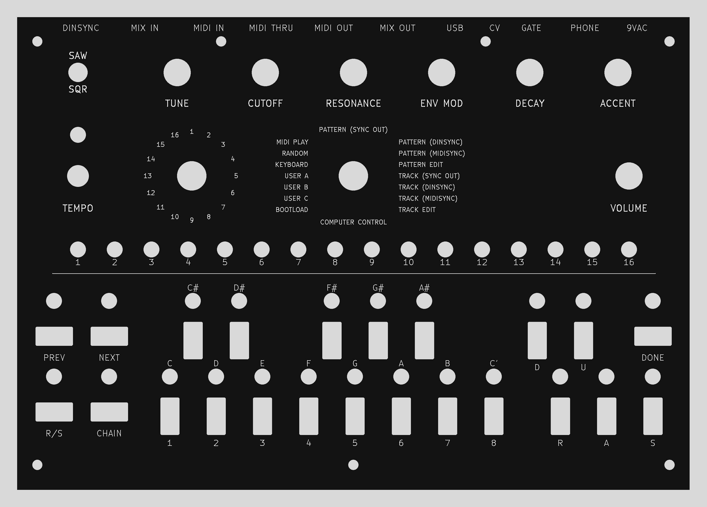
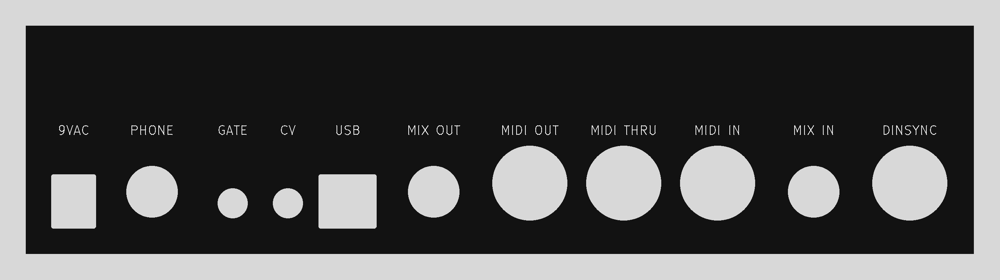

# FR-4 main and rear panels

The two panels of the PT-10 case, drawn as KiCad boards so a PCB fab can make them: black solder mask, white silkscreen legends, plain FR-4 with almost no copper.

**Status: designed and checked in KiCad and against drawings. Nothing has been ordered, made or fitted.** Fit margins come from part drawings and the fab's published tolerances. Only real panels on a real case can settle them.





## What to order

| | Main panel | Rear panel |
|---|---|---|
| Upload | `fabrication/mainpanel/x0xb0x-mainpanel-rev1-fabrication.zip` | `fabrication/iopanel/x0xb0x-iopanel-rev1-fabrication.zip` |
| Size | 232.41 x 163.27 mm | 217.93 x 52.58 mm |
| Holes | 47 drilled, 11 routed | 9 routed |
| Rectangular cuts | 23 | 2 |
| JLCPCB, 5 pieces, before shipping | $22.30 | $9.60 |

The ZIPs aren't in Git, like every ZIP here. `make_package.py` rebuilds them, and `verification.json` holds the hashes of the current pair.

Both ZIPs were uploaded to JLCPCB's quote page on 2026-11-05, and it read each as a 2-layer board of the right size. Those uploads came from the export just before the current one, with the same geometry. The price held with black mask and Remove Mark on the main panel. Nothing was put in a cart. The page reads files automatically, and an engineer reviews them only after an order.

Settings to choose:

- FR-4, 2 layers, 1.6 mm, black mask, white silkscreen.
- **Mark on PCB: Remove Mark.** Otherwise an order number can land on the face.
- Surface finish doesn't matter: no copper is exposed.
- PCB Remark: `Front panel with no circuit. The only copper is the small rings, on purpose.`

## Differences from the original drawings

Holes and cuts come from `../visualization/blender-case-revision-7/panels/original-panels.json`, which holds Adafruit's DXF geometry. Centres are unchanged. These sizes are wider, because the original fits leave too little room for this fab's tolerances:

| Feature | DXF | Here | Why |
|---|---|---|---|
| 40 LED holes | 5.08 mm | 5.40 mm | The WP7113ID lens is 5 mm +/-0.25, so a 5.08 mm hole can be too small. The 5.9 mm flange (5.65 mm at its smallest) still can't pass the largest hole, 5.53 mm |
| S1 toggle hole | 6.35 mm | 6.60 mm | Routed holes are +/-0.2 mm and the bushing can need 6.2 mm |
| CV, GATE holes | 6.35 mm | 6.80 mm | The MJ-3536N axis sits 0.166 mm off the hole centre, leaving 0.009 mm in the DXF |
| 23 button cuts | 6.35 x 12.7 mm | 6.55 x 12.9 mm | Non-plated slots are +/-0.2 mm and the buttons are up to 0.092 mm off centre, which could pinch a 5.9 mm cap |
| USB, power cuts | bottom edge on the jack body | 0.3 mm wider each side, 0.4 mm lower | The DXF bottom edge is exactly at the board surface, so no clearance is left |
| All rectangular cuts | square corners | 0.5 mm radius | JLCPCB doesn't make square-cornered cuts. The 0.5 mm is my choice; the page gives no radius |

Added: seven copper rings on each face of the main panel and three on each face of the rear panel. See "Copper" below.

## Fit margins

From `verification.json`. "Worst" takes the largest part, the smallest hole and the axis offset together. Holes under 6.3 mm use the through-hole tolerance, +0.13/-0.08 mm, because the page gives no figure for plain drilled holes. Larger holes and cuts use +/-0.2 mm.

| Part | Hole, mm | Part, mm | Offset, mm | Nominal margin, mm | Worst margin, mm |
|---|---|---|---|---|---|
| LED lens, WP7113ID | 5.40 | 5.25 | 0 | 0.075 | 0.035 |
| Toggle bushing, B12AB | 6.60 | 6.2 | 0 | 0.20 | 0.10 |
| Encoder bushing, 290VAA5F201B2 | 7.49 | 7.0 | 0 | 0.25 | 0.15 |
| Rotary bushing, 25LB22-H | 10.08 | 9.525 | 0 | 0.28 | 0.18 |
| Pot sleeve | 9.35 | 9.0 | 0 | 0.17 | 0.07 |
| 4-40 screw | 3.45 | 2.845 | 0.2455 | 0.06 | 0.02 |
| 1/4 in jack nose, NYS216 | 11.81 | 11.0 | 0.082 | 0.32 | 0.22 |
| 1/8 in jack bushing, MJ-3536N | 6.80 | 6.0 | 0.166 | 0.23 | 0.13 |
| DIN shell, SDS-50J | 17.14 | 14.2 | 0.018 | 1.46 | 1.36 |

- The LED and screw margins are the tightest. The 0.2455 mm screw offset is in the original drawing and applies to four of the seven mounts; standoffs can also float in the board's 3.302 mm holes.
- Button caps, 12.1 x 5.9 mm: worst 0.13 mm on the short side and 0.21 mm on the long side. The cap's square corner clears the 0.5 mm radius.
- USB and power bodies: worst 0.43 mm at the sides, 0.20 mm at the bottom, 0.78 mm or more at the top.
- The outer size has 0.2 mm or more to spare per axis in PacTec's top-panel recess (232.81 x 163.73 mm), with the outline +/-0.2 mm.

## Legends

There are 100 labels on the main panel. The wording comes from `../visualization/blender-case-revision-7/source-review/original-photo-label-map.json`, read from Ladyada's panel photograph. That photograph is all rights reserved and isn't copied or traced here, and the original artwork was never recovered. So:

- **Positions are set here from the holes they name,** so labels stand square to their controls. They aren't the original artwork's positions.
- **The rear port names along the top edge stand straight in front of their jacks.** This moves them up to 3.9 mm from where the photograph puts them.
- **The rear panel's 11 names are added here,** repeating those on the main panel's top edge. DIN1 is MIDI OUT, DIN2 is MIDI THRU, DIN3 is MIDI IN and DIN4 is DINSYNC, as in `../../docs/din-midi-correction.json`.
- **No title is added,** because the photographed panel has none.
- **The font is KiCad's stroke font,** so the files need no font installed. The smallest text is 1.5 mm high with 0.17 mm lines, against JLCPCB's limits of 1.0 and 0.15 mm.

## Copper

The panels carry almost no copper, for two reasons:

- The signal-integrity study (`../../../x0xb0x-si-emc/REPORT.md`, section 12) puts metal panels about 10 dB worse near 100 MHz than no panels. That is a model, not a measurement.
- A forum post from about 2020 reports JLCPCB refusing a panel because it had no copper layer, and says that a copper area fixed it. So each face has a few unconnected rings, under the mask: 50.6 mm² per face on the main panel, under the seven screw heads, and 61.7 mm² on the rear panel, under the nuts of the three 1/4 in jacks. Their effect wasn't modelled, and they are small beside a whole panel.

## Flex

The mainboard hangs from the main panel on seven standoffs. The original assembly page puts the four short ones in the corners, through the case flanges. The other three, one at the bottom middle and two at the top, tie board and panel together. So a press on a button or knob bends the board, and through those three standoffs the panel too.

`flex_check.py` models panel and board as thin plates with 1 mm elements: the panel with its holes and cuts from the exported files, the board as a plain plate. Each button and knob is pressed in turn, and so is the panel itself at points between its holes. PacTec's drawing doesn't settle whether the panel edge bears on the case ledge, so both cases are computed.

Results at a firm 10 N press, in mm. The TL1100F160Q switch itself operates at 1.57 N (160 gf); scale by 0.157 for that. Distributors give 0.3 mm switch travel.

| Panel | Corners only: worst button | Corners only: worst control | Corners only: panel pressed | On the ledge: worst button | On the ledge: panel pressed |
|---|---|---|---|---|---|
| FR-4 1.6 mm | 1.45 (S21) | 1.58 (VR4) | 1.82 | 0.76 (S5) | 0.68 |
| FR-4 1.44 mm, the thinnest allowed | 1.61 | 1.76 | 2.14 | 0.76 | 0.93 |
| FR-4 2.0 mm | 1.14 (S9) | 1.18 (VR4) | 1.22 | 0.76 | 0.35 |
| Aluminium 1.575 mm, as designed | 0.95 (S9) | 0.97 (S4) | 0.87 | 0.76 | 0.20 |

"Panel pressed" is the worst point: on the top edge between the two top standoffs with the corners only, and the middle on the ledge.

- **The board alone gives 0.76 mm** at S5, on the left edge between two corner standoffs: 0.12 mm at the switch's own force. That is the same with any panel, and so with the original.
- **If the panel bears on the ledge,** FR-4 changes nothing under the buttons and knobs. Pressed directly, it sinks 0.68 mm against 0.20 mm for aluminium.
- **If only the corners hold it,** the buttons sink 1.45 mm against 0.95 mm, which is 0.23 against 0.15 mm at the switch's own force.
- **When the case arrives, look at whether the panel edge lies on the ledge.** If it doesn't, a thin shim on the ledge makes the second case true.

**Cross-check:** `flex_ccx.py` meshes the real outlines with Gmsh and solves with CalculiX, both as installed with FreeCAD, on 2 mm second-order shell elements. It repeats the worst button, worst control and panel press for FR-4 1.6 mm and aluminium, in both cases: 12 results. All agree with `flex_check.py` within 0.5-2.0 %. In CalculiX the ledge holds the edge both ways; in `flex_check.py` the edge may lift. Results: `flex-check.json`, `flex-ccx.json`.

**Assumptions,** none of them measured:
- FR-4 at 20 GPa, where laminates are about 18-24 GPa; aluminium at 69 GPa.
- The standoffs carry only push and pull, not bending, which overstates the flex.
- The board's parts are left out, which overstates the flex; its holes are left out, which understates it a little.
- The presses are point loads.
- Everything is linear.

## Limits

- **Thickness:** JLCPCB gives 1.6 mm +/-10%, so 1.44 to 1.76 mm against 1.575 mm for the original aluminium. PacTec's drawing doesn't dimension the rear panel's groove. It looks wider than the plate on the drawing, but that isn't a dimension. If a panel binds, sand its edge, wet and with a mask: FR-4 dust is harmful.
- **Stiffness:** FR-4 is about a third as stiff as aluminium at the same thickness. See "Flex" above.
- **Pot and nut hardware:** fits above cover what passes through the panel. How far each part stands above the panel comes from earlier work on the 1.575 mm plate. FR-4 adds 0.03 mm nominally and at most 0.19 mm, taken off what stands above it: an LED lens goes from 1.30 mm to no less than 1.11 mm.
- **Appearance:** FR-4 edges and cut walls show as pale fibreglass against the black mask. Mask colour over bare FR-4 can differ slightly from mask over copper, which is another reason the rings hide under hardware.
- **The Blender scene still shows the aluminium DXF panels.** It wasn't changed.

## Rebuilding

`make_panels.py` writes both KiCad projects. `make_package.py` runs DRC, exports the Gerbers and drills, reads them back and writes `verification.json` and `previews/`. It needs a Python with Pillow, and needs no other package:

```bash
python3 -I kicad-working/panels/make_panels.py
```

```bash
../x0xb0x-si-emc/.venv/bin/python -I kicad-working/panels/make_package.py
```

The flex model, then its cross-check (about 5 and 7 minutes; the second needs FreeCAD and the first one's results):

```bash
../x0xb0x-si-emc/.venv/bin/python -I kicad-working/panels/flex_check.py
```

```bash
../x0xb0x-si-emc/.venv/bin/python -I kicad-working/panels/flex_ccx.py
```

Each export stamps its date into the Gerbers, so a fresh run changes the hashes without changing the geometry. The run on 2026-11-05 passed all 31 checks with KiCad 10.0.7: DRC, outline and every hole and cut against the DXF, read from the exported files; silkscreen at least 0.3 mm clear of edges; every word against the label map; copper limited to the rings; LEDs, controls, mounts and jacks against the KiCad 30 boards; all parts clear at worst tolerance.

## License

The panel geometry comes from the original x0xb0x drawings: Copyright (c) Limor Fried & Adafruit Industries, MIT license, in `../visualization/blender-case-revision-7/source/LICENSE-original-design.txt`. Each panel carries that credit in silkscreen on its back, as the original download page asks. `x0xb0x` is Adafruit's trademark. The label map and these scripts are CC0-1.0.
