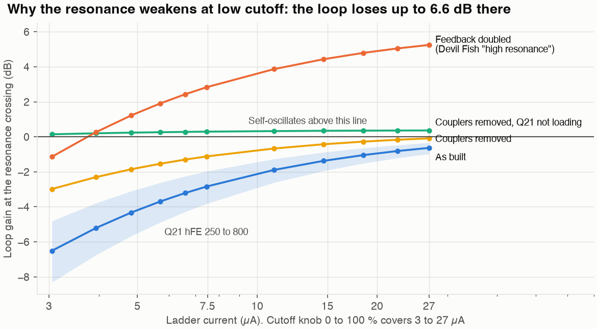
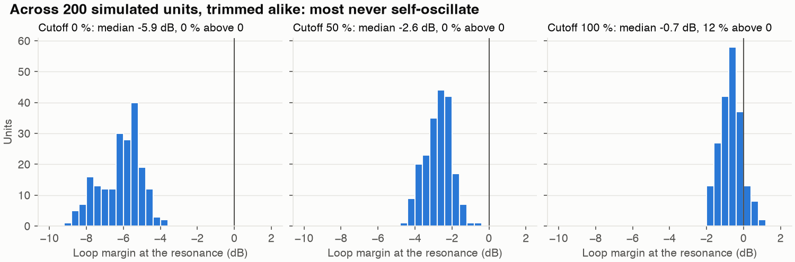
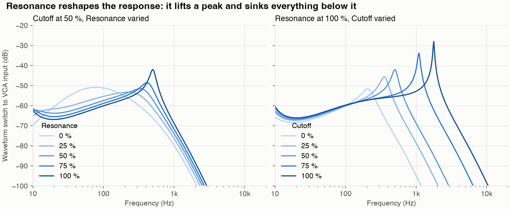
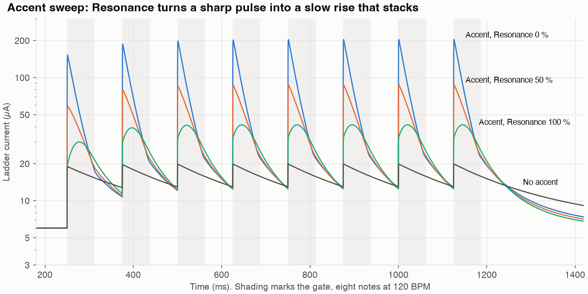
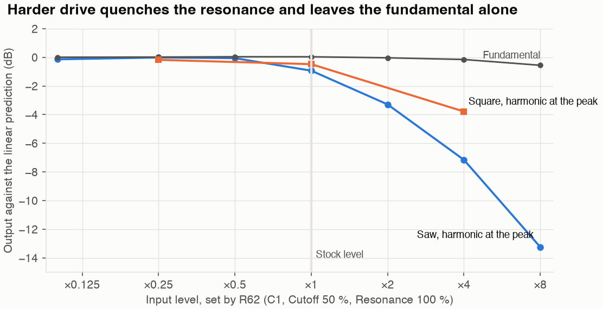
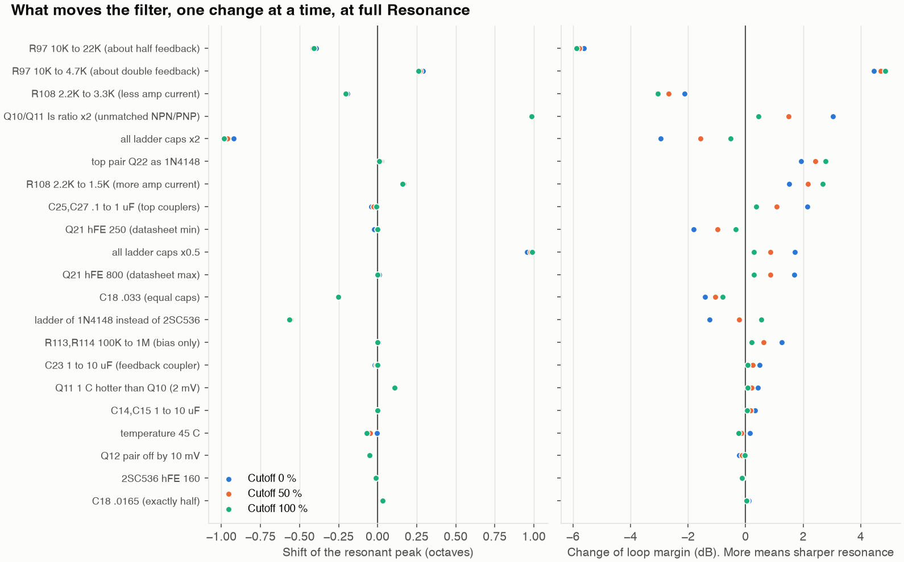

# x0xb0x VCF: simulation, and what shapes its sound

**Status: simulation only.** No unit exists yet, so nothing here has been measured on hardware. The model is checked against published analysis and published claims about the TB-303, not against a real filter.

## Short answer

The core is a four-pole diode ladder, and it behaves as Tim Stinchcombe's analysis predicts. Most of the character comes from what surrounds the core:

1. **Resonance strength depends on cutoff.** At full Resonance the peak's Q is about 2.5 at the lowest cutoff, 5.9 at the middle and 26 at the top. Roland set the feedback gain almost exactly at the point of oscillation, then losses at low current pull it back.
2. **The Resonance knob also moves the peak, by 2.7 octaves** (78 to 502 Hz at Cutoff 50 %), and takes 11 dB off the bass at the VCA input.
3. **The Env Mod and Accent circuits are not neutral.** Env Mod lowers the resting cutoff as it rises. Accent has a dead zone. Resonance turns the accent pulse into a slow rise that stacks over repeated notes.
4. **One part varies the sound most between units: Q21's hFE.** The datasheet range of 250 to 800 changes Q by 2× or more.
5. **Matching within a pair matters mainly at Q21, and for hFE.** Q22 needs none at all, and Q12 only needs its two Vbe within about 10 mV.
6. **Overall temperature and the hFE of the ladder parts matter little** in this model.

## What was simulated

- **Circuit:** the deck is generated from the revision 27 KiCad schematic (`vcf-parts.json`, exported by `extract_vcf.py`), so values and connections are not retyped. It covers the 69 VCF parts on the expanded BOM's VCF list, the output tap to the VCA, the real MEG, the accent sweep and the square shaper.
- **Tool:** ngspice 46, with small-signal, loop-gain and transient analyses.
- **Tuning:** TM3 is trimmed to the kit's tuning point, 500 Hz peak at Cutoff 50 %, Resonance 100 %. That needs 159 kΩ of its 500 kΩ.
- **Method:** each influence changes one thing from that baseline, at three cutoff settings.

"Margin" below is the loop gain at the frequency where the feedback returns in phase. At 0 dB the filter self-oscillates, and the closer to 0 dB from below, the sharper the peak.

## Does the model agree with anything?

| Check | Source says | Model gives | Result |
|---|---|---|---|
| Ladder transfer function | Stinchcombe's polynomial | Within 0.09 dB at 1 kHz, −3 dB corners match to 0.1 Hz | Agrees |
| Gain needed to oscillate, equal caps | k ≈ 18.4 (Stinchcombe) | 18.39 | Agrees |
| "18 dB/oct" is a misnomer | Ultimately 24 dB/oct (Stinchcombe) | Slope runs −6, −8.5, −12, −17, −21, −23, −24 dB/oct, octave by octave | Agrees |
| Tuning range | 500 ± 100 Hz (kit page) | TM3 reaches it, in all 200 tolerance samples for 500 Hz | Agrees |
| Square wave | About 4 Vpp on 7 V (kit page) | 3.5 Vpp on 6.9 V | Close |
| Both knobs down | "Almost sinusoidal" (kit page) | 2nd harmonic −16.6 dB, THD 15 % | Agrees |
| Self-oscillation, stock | Needs doubled feedback (Devil Fish manual) | Decays at every cutoff tested | Agrees |
| Self-oscillation, feedback ×2 | "Only at mid and high frequencies" (Devil Fish) | Sustains at Cutoff 50 and 100 %, decays at 0 % | Agrees |
| Heavy input | Quenches the resonance (Devil Fish) | −0.9 dB at stock level, −13 dB at ×8 | Agrees |
| Accent | Direct pulse with Resonance low, lag and stacking with it high (Devil Fish, Whittle) | Peak 1.2 ms after gate, against 20 to 28 ms. Stacks by 38 % | Agrees, with one difference below |
| Env Mod | Cannot reach zero (Whittle) | At 0 % the cutoff still sweeps +0.88 octave | Agrees |
| Weak bass | 32 Hz down 5 dB (Devil Fish) | −4.3 to −7.0 dB against 65 Hz; the manual gives no reference | Same order |
| Top of the Cutoff range | About 2.5 kHz (implied by Devil Fish) | 1.78 kHz with a 20 % pot taper, 2.58 kHz with 10 % | Depends on an unknown |

The last row is the one real gap. KiCad says VR3 is 50K(A), the kit page says "50K D (log)", and I found no taper curve. The model assumes 20 % of the track at half rotation, and only the knob-to-Hz map depends on this.

**One difference from the published description:** the model also stacks accents with Resonance fully down (+34 %), because C13 stays connected through the whole pot. The manual calls that position "basically a direct pulse", which fits the shape, and doesn't discuss stacking there.

## What shapes the character

### 1. Ladder current and capacitors set the frequency

The peak follows the ladder current at about 66 Hz/µA (the analysis gives 64.5). The Cutoff knob covers 3 to 27 µA. Doubling all ladder capacitors drops it one octave.

The knob sets the current linearly through R73 and TM3, and the envelope adds exponentially at the summing node N$134. One octave is 18 mV there:

- Through R63 (Env Mod), that is **1.8 V per octave**.
- Through R72 (Accent), it is **0.83 V per octave**.

### 2. Resonance strength depends on cutoff



| Margin at full Resonance | 3 µA (Cutoff 0 %) | 7.5 µA (50 %) | 27 µA (100 %) |
|---|---|---|---|
| As built | −6.51 dB | −2.84 dB | −0.64 dB |
| AC couplers removed | −2.98 dB | −1.12 dB | −0.09 dB |
| Couplers removed, Q21 not loading | +0.14 dB | +0.29 dB | +0.36 dB |
| Q (as built) | 2.5 | 5.9 | 26 |

With both losses removed, margin is nearly flat and just above zero. That means a loop gain of about 17.3 to 17.7, against 17.02 needed with these capacitors. The two losses are:

- **Q21 loading the ladder.** At 3 µA each ladder diode is about 17 kΩ, while Q21's input is about 28 kΩ per side. As current rises, the diodes fall in impedance and the loading fades.
- **The AC couplers in the feedback loop**, mostly C25 and C27. With Q21's input they form a corner near 45 to 57 Hz, which adds phase lead and costs gain at low cutoff.

This matches Whittle's note that his surgery to improve gain at lower frequencies made it "sound more like a normal filter". In the model, this loss is what makes the resonance weak at low cutoff and sharp at high cutoff.

### 3. Q21's hFE

| Q21 hFE | Q at Cutoff 0 % | 50 % | 100 % | Margin at 100 % |
|---|---|---|---|---|
| 100 | 1.1 | 2.0 | 7.3 | −2.26 dB |
| 150 | 1.4 | 2.9 | 10.7 | −1.57 dB |
| 200 | 1.6 | 3.6 | 13.9 | −1.20 dB |
| 250 (datasheet min) | 1.9 | 4.3 | 17.2 | −0.98 dB |
| 400 (baseline) | 2.5 | 5.9 | 26.1 | −0.64 dB |
| 800 (datasheet max) | 3.4 | 8.6 | 50.1 | −0.34 dB |

Across 200 simulated units, each retrimmed to 500 Hz, none self-oscillates at Cutoff 0 or 50 %, and 12 % do at Cutoff 100 %. Ranges were ±5 % resistors, ±10 % film caps, ±20 % electrolytics, the full hFE ranges and ±3 mV pair offsets. In this run both halves of a pair share one hFE.



### 4. Matching within a pair

This table changes one pair at a time and gives Q at full Resonance, at Cutoff 50 % and 100 %. "hFE 800 and 250" is well outside the datasheet's pair limit of 0.8, and 30 mV is well outside its 10 mV maximum, so those rows stand for two separate, unselected transistors.

| Difference between the two halves | Q12 | Q21 | Q22 |
|---|---|---|---|
| None | 5.9 / 26.1 | 5.9 / 26.1 | 5.9 / 26.1 |
| Vbe 1 mV (datasheet typical) | 5.9 / 26.1 | 5.9 / 26.1 | 5.9 / 26.1 |
| Vbe 10 mV (datasheet maximum) | 5.6 / 24.1 | 5.8 / 25.1 | 5.9 / 26.1 |
| Vbe 30 mV | 4.1 / 16.7 | 5.5 / 20.4 | 5.9 / 26.1 |
| hFE 400 and 320 (datasheet limit) | 5.9 / 26.1 | 5.3 / 21.7 | 5.9 / 26.1 |
| hFE 800 and 250 | 5.9 / 26.1 | 4.3 / 9.9 | 5.9 / 26.1 |
| Vbe 30 mV and hFE 800 and 250 | 4.1 / 16.7 | 3.3 / 5.7 | 5.9 / 26.1 |

- **Q22 needs no matching in the model.** It is a common-base stage, so a Vbe difference is only a constant voltage across the top of the ladder, which C25 and C27 block. Its base current has almost no effect.
- **Q12 needs only its Vbe within about 10 mV.** An offset steers the current to one side, which lowers the pair's gain and the loop gain. At 30 mV the peak also falls 0.45 octave, which TM3 can trim back, and the notes drop 1.4 dB. Its hFE doesn't matter, because its base current is tiny at 2 to 13 µA per side.
- **Q21 needs matched hFE, and its Vbe matters less.** It runs near 0.26 mA per side, so its base current drops real voltage across R113 and R114. With hFE 800 and 250 the collector N$140 moves from 6.19 V to 4.2 or 8.1 V, depending on which half has which. That same drop opposes a Vbe offset, which is why Q21 tolerates 10 mV.

**Envelope leakage.** With no audio going in, the MEG's sweep of the ladder current should cancel between the two sides. At the VCA input, while the VCA would be open, the levels against the notes are:

| Case | Leakage against the notes |
|---|---|
| Matched pairs | −56.6 dB |
| Q12 Vbe off by 10 mV | −52.2 dB |
| Q12 Vbe off by 30 mV | −42.7 dB |
| Q21 hFE 800 and 250 | −53.2 or −64.2 dB, depending on which half has which |
| Q22, any case above | −56.5 to −56.7 dB |

Most of Q12's leakage is a short pulse at the gate, in the first 4 ms: 0.47 mV at 10 mV offset, against 14 mV notes. The Devil Fish manual puts the VCA's opening at about 4 ms, so the real VCA, which is not simulated, decides how much of it is heard.

The results of this section are stored in `results/pair_matching.json` and `results/envelope_leak.json`.

**Why the original uses duals is not settled here.** I found no Roland statement of the reason. A dual guarantees these limits without sorting parts and keeps both halves at one temperature, and this model tests neither factory spread nor drift between halves. Reading these results as permission to drop the duals goes beyond what was simulated.

### 5. What the Resonance knob does



At Cutoff 50 %, the peak moves 78, 224, 336, 415, 502 Hz at Resonance 0, 25, 50, 75, 100 %. Bass falls as the feedback grows: at 65 Hz the signal at Q19's emitter drops 18 dB.

The VCA input drops only 11 dB, because a second tap through R122 from the pot wiper gives back about 7 dB at full Resonance.

### 6. Output tap and weak bass

The VCA is fed through two high-pass paths: C21 with R121 at about 72 Hz, and C20 with R122 at about 156 Hz. Making these capacitors large removes the bass loss in the model (32 Hz against 65 Hz goes from −4.3 dB to 0 dB).

### 7. Envelope and accent



- **Env Mod lowers the resting cutoff.** A decayed MEG sits below the 3.26 V reference node, so more Env Mod pulls the rest point down. Ladder current at rest is 7.24, 5.99 and 2.59 µA at 0, 50 and 100 %, which is −1.5 octaves. Peaks reach 13, 20 and 113 µA.
- **The MEG swings to about 10 V** and decays with (R138 + VR6) × C62, so 68 ms to about 1.1 s as the time constant. An accent shorts VR6.
- **The accent has a dead zone.** D24 must rise above the 3.25 V summing node, so at Resonance 100 % an Accent pot below about 50 % barely moves the filter (20 µA against 41 µA at 100 %). The VCA's accent path, not simulated here, is separate.
- **Resonance changes the accent's shape.** The peak comes 1.2 ms after the gate up to Resonance 50 %, and 20 to 28 ms after it at 100 %.
- **Accents stack.** Over repeated accents at 120 BPM, peak current goes 30, 39, 41, 41 µA at Resonance 100 %, because C13 keeps charge between notes.

This supports Stinchcombe's suspicion that the envelope circuitry matters as much as the core or more. It cannot settle the point, since that is a judgement about sound.

The accent line timing comes from stock `synth.c`: it is active low and holds until the next note, even after the gate falls.

### 8. Input level



The saw arrives at Q12 at about 58 mV peak-to-peak, or 86 mV with the feedback at full Resonance, which is already large for a differential pair. Harder drive quenches the harmonic at the peak and leaves the fundamental nearly alone. The square loses less.

### 9. The bottom capacitor

C18 at .018 µF instead of .033 µF raises the peak 0.25 octave and adds 0.8 to 1.4 dB of margin. Compared with exactly half (.0165 µF), the difference is 0.03 octave. The needed gain falls from 18.39 to 17.02, so this helps a little, and the model still gives no strong reason for it. Stinchcombe left the purpose open too.

### 10. Everything else



| Change | Peak shift | Margin change (Cutoff 0 / 50 / 100 %) |
|---|---|---|
| Q10/Q11 current ratio ×2 | +0.98 octave (TM3 trims it) | +3.03 / +1.48 / +0.45 dB |
| R97 10K to 4.7K (about double feedback) | +0.27 octave | +4.45 / +4.68 / +4.84 dB |
| R108 2.2K to 3.3K (less amp current) | −0.20 octave | −2.12 / −2.67 / −3.06 dB |
| Ladder of 1N4148 instead of 2SC536 | −0.56 octave | −1.26 / −0.22 / +0.54 dB |
| Top pair Q22 as 1N4148 | +0.02 octave | +1.94 / +2.41 / +2.78 dB, self-oscillates at the top |
| Q11 1 °C hotter than Q10 (2 mV assumed) | +0.11 octave | Small |
| Whole circuit at 45 °C | 0 to −0.07 octave | Small |
| Q12 pair off by 10 mV (datasheet max) | −0.05 octave | Under 0.25 dB |
| Q21, Q22 or ladder off by 10 mV | None | Under 0.05 dB |
| hFE of Q22 | None | None |
| hFE of Q12, 250 to 800 | Up to 0.01 octave | Under 0.05 dB |
| hFE of the 2SC536 ladder, 160 to 320 | Up to 0.01 octave | Under 0.15 dB |

**An open question from the paper:** Stinchcombe saw about 6 dB of extra gain with 1N4148s at the top of the ladder, and suspected the emission coefficient. In SPICE that holds up: +4.66 dB with the diode's N = 1.752, and back to −0.12 dB when N is forced to 1. This shows what SPICE does with its diode model; I did not test real diodes.

## For a build

- **Q21 is the part to choose carefully.** This bears on the choice between original parts and adapter pairs.
  - BCM847BS is specified at 200 to 450 ([Diotec datasheet](https://diotec.com/request/datasheet/bcm847bs.pdf), at 2 mA), which overlaps only the lower part of the 2SC1583's range.
  - For DMMT3904W I only confirmed a minimum of 100 at 10 mA ([Diodes](https://www.diodes.com/part/view/DMMT3904W)), which would risk much weaker resonance.
  - Measure candidates at about 0.26 mA, where Q21 actually runs. In the model hFE 300 costs about 20 % of Q against hFE 400, and hFE 150 about half. I don't know which rank Roland or the kits used, so hFE 400 is only my baseline.
- **Matching within a pair:** the two halves of Q21 are worth matching for hFE. Q12 only needs its Vbe within about 10 mV, which a factory dual already meets by its datasheet. Q22 needs nothing. Q26 is in the VCO, so none of this applies to it.
- **Expected DC voltages (model, Cutoff 50 %):**

| Node | Where | Volts |
|---|---|---|
| N$561 | Q9 emitter | 3.26 |
| N$147 | Q10 emitter | 3.78 |
| N$127 | Q12 emitter | 4.83 |
| N$143, N$120 | Q22 emitters (ladder top) | 11.35 |
| N$138, N$141 | Q21 bases | 3.47 |
| N$139 | Q21 emitter | 2.86 |
| N$140 | Q21 collector | 6.19 |
| N$144 | Q19 emitter | 5.56 |
| N$130 | Q18 emitter | 4.36 |

- **Three measurements would calibrate the model** once a unit runs:
  1. The peak frequency at Cutoff 0 and 100 %, which settles the pot taper.
  2. Q21's actual hFE.
  3. The decay of a ring at Resonance 100 %, which tests the margin values directly.

## A prediction nobody has confirmed

The loop also has a second crossing, below the audio band, around 6 to 8 Hz, formed by the four couplers. As built its margin is −7.6, −3.4 and −1.0 dB at Cutoff 0, 50 and 100 %.

In the tolerance run, 46 % of units go slightly above 0 dB at Cutoff 100 % and Resonance 100 %. In the transient run at hFE 800 it grows slowly, from 1.7 to 10 mV peak-to-peak at Q19's emitter over 15 s, and only 0.02 mV reaches the VCA input. So it looks inaudible, unless it grows much further than I ran it. I found no report of this on a real TB-303 or x0xb0x. A scope on Q19's emitter with no notes playing would settle it.

## What is uncertain or left out

- **Transistor models are substitutes.** hFE, fT and Cob come from the datasheets. IS, VAF and the capacitance split are generic values, because no datasheet gives them.
- **2SA733 data is not from a datasheet in the repo.** The hFE of 300 assumes the P rank.
- **Pot tapers are assumed**, and no pot tolerance is included.
- **Noise and thermal drift between the halves of a pair are not simulated.** A pair's halves share one temperature here. A 1 °C difference is roughly a 2 mV Vbe offset.
- **In all the filter results above, the VCO is an ideal linear saw** at kit-documented levels (5.5 Vpp on 8.5 V), and the stop point is the VCA's input network. C36 and R119 load the accent, but D27's path is left out. [The whole analog section](#the-whole-analog-section) simulates these parts, and is covered separately.
- **The sources describe the TB-303, not the x0xb0x.** At least one value differs: Whittle gives a 100k accent pot, and this board has 50K. I did not compare the two schematics part by part.
- **Open303 differs.** Robin Schmidt's digital model uses a 150 Hz high-pass in the feedback, plus 44 and 24 Hz high-passes and a notch near 7.5 Hz. The circuit has no single corner at 150 Hz, and I cannot say how the two relate.
- **The four audio files in the next section** come from the transient simulation up to the VCA input. The gain envelope applied after that is my approximation of the VCA, based on timing in the Devil Fish manual. Treat them as an illustration of the filter. The `demo-full-*` files need no such envelope.

## Audio

These are the same 4 s pattern, written for this test and rendered from the circuit, in `results/`:

| File | Settings |
|---|---|
| `demo-saw.wav` | Saw, Cutoff 35 %, Resonance 85 %, Env Mod 60 %, Decay 35 %, Accent 80 % |
| `demo-square.wav` | The same with the square wave |
| `demo-saw-res-low.wav` | The same saw with Resonance 15 % |
| `demo-saw-no-accent-sweep.wav` | The same saw with R72 removed, so accents don't move the filter |

## The whole analog section

`fullchain.py` puts the rest of the analog board into one deck: the 6-bit CV DAC and buffer, slide, the transistor-level VCO and square shaper, the filter, both envelopes, accent, the VCA and the mixer. The gate, slide, accent and note lines follow the stock firmware's `note_on` and `note_off`. The output is taken at N$7, the MIX OUT jack, so the WAVs below have no gain envelope added afterwards. The levels are not fitted to the kit's figures, only TM3, TM4 and TM5 are trimmed, as on a real unit.

| Check | Source says | Model gives |
|---|---|---|
| CV for the three C notes | 2, 3, 4 V (kit page) | 2.000, 3.000, 4.000 V |
| Pitch after trimming TM4 and TM5 | 65.4, 130.8, 261.6 Hz | 65.42, 130.84, 261.65 Hz |
| Saw | 5.5 Vpp on 8.5 V (kit page) | 5.4 Vpp on 8.3 V |
| Square | About 4 Vpp on 7 V (kit page) | 3.6 Vpp on 6.9 V |
| Gate and strike pulse | 12 V (kit page) | 12.0 and 11.9 V |
| VCA opening after the gate | 1 to 5 ms, typically 4 (Devil Fish) | 5.6 ms to half level |
| VCA closing after the gate | About 16 ms (Devil Fish) | 14 ms |
| Slide time constant | 22 ms (R-2R and C35, calculated here) | 22.0 ms |

Line output comes out at about 2 V peak-to-peak with these settings, and up to 3 V on the brightest one. I found no published figure to compare that with.

| File | Settings |
|---|---|
| `results/demo-full-saw.wav` | Saw, Cutoff 35 %, Resonance 85 %, Env Mod 60 %, Decay 35 %, Accent 80 % |
| `results/demo-full-square.wav` | The same with the square wave |
| `results/demo-full-saw-open.wav` | Saw, Cutoff 60 %, Resonance 60 %, Env Mod 85 %, Decay 50 %, Accent 100 % |

**What in this deck is a stand-in:**

- **IC15 (BA6110):** a plain bipolar OTA with a unity buffer, its output current Iabc·tanh(Vd/2VT). I could not get a usable datasheet, so its gain law, input resistance and any linearising diode are assumed, and its polarity is unknown. This sets the level and the distortion at the VCA.
- **IC11 (AN6562):** a generic op-amp, 100 dB gain, 3 MHz, output limited 0.7 V from ground and 1 V from the supply.
- **Q27:** given hFE 150 and a reverse gain of 1, below the 2SA733P rank. The VCO core is a latch made of Q25 and Q27, and it only lets go when Q27 runs out of drive in saturation. With the generic PNP model it stuck at the top of the ramp above about 3 V of CV. No datasheet gives this behaviour, so these values are fitted so that it reaches the top note.
- **Ideal:** the rails, IC9 and the CPU lines. R100A and R100B are 1 kΩ at 25 °C, with no temperature change.
- **Left out:** the headphone amp (IC14), the power supply, noise and hum. Rests are therefore quieter than on a real unit.

## Sources

- Tim Stinchcombe, [Analysis of the Moog transistor ladder and derivative filters](https://www.timstinchcombe.co.uk/synth/Moog_ladder_tf.pdf), and his [poles page](https://www.timstinchcombe.co.uk/index.php?pge=poles)
- Robin Whittle, [What makes the TB-303 unique](https://www.firstpr.com.au/rwi/dfish/303-unique.html), and the [Devil Fish manual](https://www.firstpr.com.au/rwi/dfish/Devil-Fish-Manual.pdf)
- Adafruit x0xb0x kit pages, [VCF](https://raw.githubusercontent.com/x0xb0x/x0xb0x.github.io/HEAD/pages/ladyada.net/make/x0xb0x/fab/vcf/index.html) and [VCO](https://raw.githubusercontent.com/x0xb0x/x0xb0x.github.io/HEAD/pages/ladyada.net/make/x0xb0x/fab/vco.html)
- Robin Schmidt, [Open303](https://github.com/RobinSchmidt/Open303)
- Datasheets in the hardware repo: Mitsubishi 2SC1583 and 2SC2291, Sanyo 2SC536
- Stock x0xb0x firmware `synth.c`, for the accent polarity and timing

Third-party papers and web pages are linked here, not copied into the repository.

## Rerun

From this folder, with ngspice on the PATH and numpy and matplotlib installed. The whole run takes about 15 minutes on eight cores.

```bash
python3 calibrate.py
python3 sweeps.py
python3 timedomain.py
python3 pairs.py
python3 nonlinear.py
python3 extras.py
python3 plots.py
python3 fullchain.py tune
python3 fullchain.py check
python3 fullchain.py render
```

`python3 fullchain.py parts` rewrites `fullchain-parts.json` from the schematic. The three renders take under a minute together.

`python3 verify_report.py` runs no simulation. It checks the stored results against the sources above and writes [`docs/vcf-simulation.json`](../../../docs/vcf-simulation.json). It needs `kicad-cli` to compare `vcf-parts.json` with the schematic; `extract_vcf.py --check` does that comparison alone, and `extract_vcf.py` rewrites the file.

Results are kept as JSON in `results/`. The long waveform arrays go to `native-probes/`, which git ignores, and `plots.py` reads them, so `timedomain.py` must run before it.
