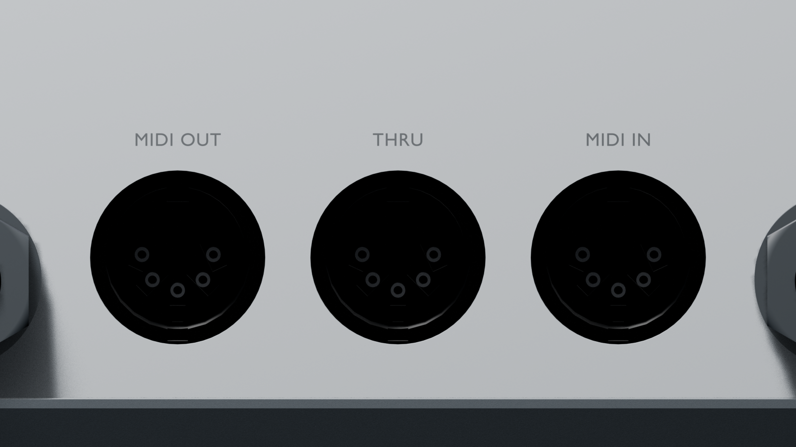

# x0xb0x complete enclosure — Blender revision 13

Open `x0xb0x-populated-with-case.blend` with Blender 5.0.0 or later. All populated board geometry and resources are embedded.

This revision corrects the contact pattern of all four drawing-derived SDS-50J models. The two outer contacts lie on the horizontal diameter. The primary drawing's 25-degree leaders describe their elongated slot tilts; our previous model incorrectly used those angles for their center positions. The three lower contacts and nominal body envelope are preserved.

The scene retains all 491 native component references, 40 PCB-mounted LEDs, 23 PCB-attached button caps, original panels and enclosure, rear audio hardware, editable legends, materials and animation. Only the four native DIN mesh datablocks and their source metadata change. The rear functions remain DIN1 MIDI OUT, DIN2 THRU, DIN3 MIDI IN and DIN4 SYNC.

| Frame | View |
| --- | --- |
| 1 | Assembled enclosure |
| 80 | Exploded enclosure and populated boards |
| 120 | Control-side switch inspection, caps intentionally hidden |
| 160 | Illustrative wiring study |

The [saved-scene audit](verification/final-saved-scene-audit.json) reopens revisions 12 and 13, compares complete object/data snapshots and evaluated instances across all four views, and verifies the current rear passages. The previous model fails the corrected contact-center regression at exactly the four DIN connectors. The [current aperture check](verification/rear-openings-audit.json) passes 44 checks using 974 rays through the complete assembled geometry.

The [model source review](../../validation/models-review-12/README.md) records primary-drawing interpretation, solid and native KiCad checks, and the limited KiCad model-path changes. The user-supplied Warehouse CAD was also placed into two separate local case comparison scenes. Its flange dimensions and body-to-pin registration differ from the current drawing and PCB; it has not replaced the active drawing-derived model.

The existing audio-housing and power/USB panel-edge intersections remain documented in the [seating review](../../validation/rear-seating-review/scene-audit/README.md). Exact vendor identity, slot widths, cavity depths, omitted solder terminals, molding details, switch travel, tolerances and wiring routes remain qualified. These checks do not establish physical fit or fabrication readiness.
