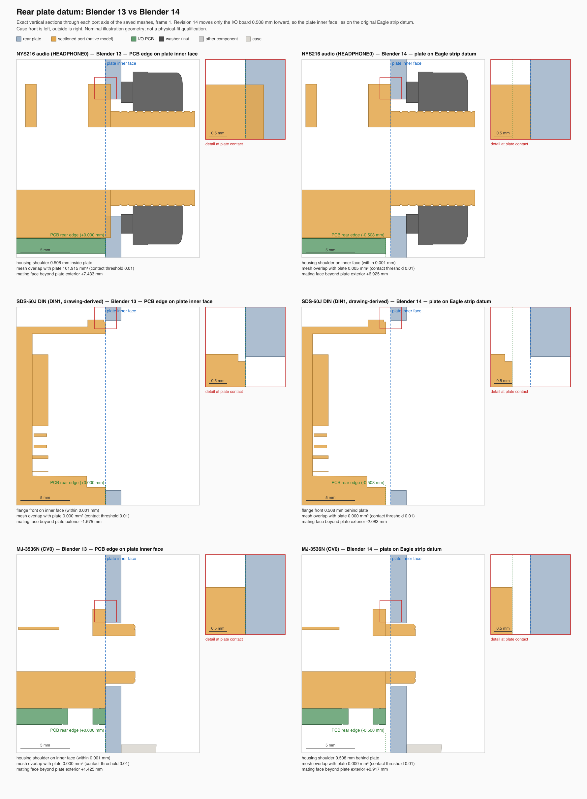

# x0xb0x complete enclosure — Blender revision 14

Open `x0xb0x-populated-with-case.blend` with Blender 5.0.0 or later. All populated board geometry and resources are embedded.

This revision seats the rear plate on the datum drawn in the original Eagle I/O board. A detached Dimension-layer strip lies 0.508 mm (0.020 in) behind the PCB rear edge, and all three REAN audio footprint origins sit exactly on its inner edge. The original finishing manual clamps the rear plate with those three jacks. Revision 13 placed the plate inner face on the PCB rear edge instead, so each audio housing shoulder ran 0.508 mm (about 102 mm³) into the plate.

Only the I/O board placement moves, 0.508 mm toward the case front. Its 24 wiring-study endpoints and 5 labels move with it, and the 24 illustrative conductors blend only their last 20 mm onto the moved endpoints. The hidden historical strip reference is parented to the board, so its inner edge now lies on the plate inner face. No mesh, material, keyframe, plate, case, hardware or mainboard pose changes. The scene retains all 491 native component references, 40 PCB-mounted LEDs, 23 PCB-attached button caps, the SDS-50J contact correction, the MIDI legends and all four views.

| Frame | View |
| --- | --- |
| 1 | Assembled enclosure |
| 80 | Exploded enclosure and populated boards |
| 120 | Control-side switch inspection, caps intentionally hidden |
| 160 | Illustrative wiring study |

Measured on the saved meshes, revision 13 → 14:

| Port | Shoulder / flange vs plate inner face | Mesh overlap with plate |
| --- | --- | --- |
| HEADPHONE0, MIXIN0, MIXOUT0 | 0.508 mm inside → seated (within 0.001 mm) | ≈101.9 → ≤0.005 mm³ (surface contact) |
| DIN1–DIN4 | flush → 0.508 mm behind | 0 → 0 |
| CV0, GATE0 | flush → 0.508 mm behind | 0 → 0 |
| POWER0, USB0 | front passes through the cutout | 1.148 / 1.536 mm³, unchanged |

The audio nose now projects 0.725 mm past the nut, the value the earlier source audit predicted for a seated shoulder. A triangle-level screen of the I/O board against every other rendered mesh finds 15 contacting pairs in revision 13 and 5 here, and no new pairs. The pairs removed are the DIN/MJ fronts and PCB edge touching the plate. The user-downloaded Warehouse SDS-50J mesh is kept in local comparison scenes, as before. With its rigid pin fit, its flange now clears the plate by 0.388 mm instead of entering it by 0.12 mm.

The [saved-scene audit](verification/final-saved-scene-audit.json) reopens revisions 13 and 14 and compares complete object/data snapshots and evaluated instances across all four views. The [aperture check](verification/rear-openings-audit.json) passes 44 checks using 974 rays, and the shared [portability check](verification/portable-scene-audit.json) passes 106 checks. The [validation summary](verification/independent-validation-summary.json) collects the evidence, measurements, DIN pin-pattern comparison and limits.

Reading the strip as the plate section is an interpretation: the strip is 222.25 mm wide against the 217.932 mm plate. The POWER/USB bodies still sit 0.081 mm below their rectangular cutouts, and the 0.167 mm MJ-versus-NYS216 axis-height disagreement remains. Vendor variants, terminal registration, tolerances and wiring routes remain qualified. These checks do not establish physical fit or fabrication readiness.
