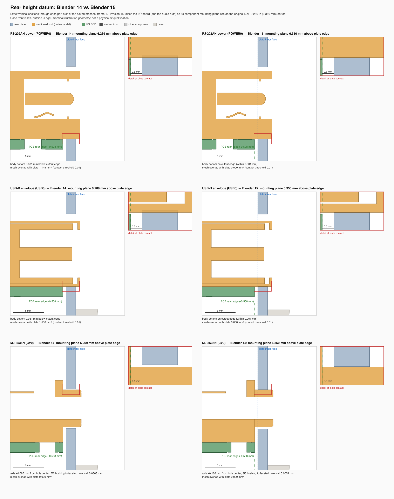

# x0xb0x complete enclosure — Blender revision 15

Open `x0xb0x-populated-with-case.blend` with Blender 5.0.0 or later. All populated board geometry and resources are embedded.

This revision seats the I/O board on the height datum of the original rear-panel DXF. Every cutout in that drawing is measured from a component mounting plane 0.250 in (6.350 mm) above the plate's lower edge:

| Cutout | DXF height | Above 0.250 in | Modelled part |
| --- | --- | --- | --- |
| POWER0, USB0 rectangles, bottom edge | 0.250 in | 0 | body bottom on the PCB |
| Three audio holes | 0.565 in | 8.001 mm | NYS216 axis 8.0 mm |
| Four DIN holes | 0.643 in | 9.982 mm | SDS-50J axis 10.0 mm |
| CV0, GATE0 holes | 0.460 in | 5.334 mm | MJ-3536N axis 5.5 mm |

Revision 14 placed the mounting plane 6.269 mm above the plate edge, a compromise between the audio and CV/GATE holes. That left the POWER/USB bodies 0.081 mm below their cutouts. Revision 15 raises only the I/O board placement by 0.0810 mm, so the plane lies at 6.3500 mm. Its wiring-study endpoints move with it, and the 24 illustrative conductors blend only their last 20 mm.

The three audio nut proxies move too, because they screw onto the jack bushings. A local trial that moved only the board left them 0.081 mm off-axis, and the rear-opening verifier failed them. The washers stay centred on the plate holes.

Revision 14's axial plate datum, all 491 native component references, the case, plate, LEDs, caps, legends and all four views are preserved.

| Frame | View |
| --- | --- |
| 1 | Assembled enclosure |
| 80 | Exploded enclosure and populated boards |
| 120 | Control-side switch inspection, caps intentionally hidden |
| 160 | Illustrative wiring study |

Measured on the saved meshes, revision 14 → 15:

| Port | Vertical registration | Mesh overlap with plate |
| --- | --- | --- |
| POWER0, USB0 | body bottom 0.081 mm below → on the cutout edge | 1.148 / 1.536 → 0 mm³ |
| Three audio jacks | axis 0.082 mm low → centred (0.001 mm); nut and washer coaxial | contact only |
| DIN1–DIN4 | axis 0.063 mm low → 0.018 mm high | 0 |
| CV0, GATE0 | bushing to hole wall 0.086 → 0.005 mm | 0 |

No port overlaps plate material. A triangle-level screen of the I/O board against every other rendered mesh finds 5 contacting pairs in revision 14 and 3 here, the seated audio shoulders, with no new pairs. With the current models the board height is nearly forced: the POWER/USB bodies clear only at 6.350 mm or above, and the Ø6 mm CV/GATE bushings clear their Ø6.35 mm holes only up to about 6.359 mm.

The [saved-scene audit](verification/final-saved-scene-audit.json) reopens revisions 14 and 15 and compares complete object/data snapshots and evaluated instances across all four views. The [aperture check](verification/rear-openings-audit.json) passes 44 checks using 974 rays, and the shared [portability check](verification/portable-scene-audit.json) passes 106 checks. The [validation summary](verification/independent-validation-summary.json) collects the evidence, measurements and limits.

The original CV/GATE holes imply a 5.334 mm (0.21 in) jack axis, while the current MJ-3536N drawing gives 5.5 mm, so the modelled bushings clear by only about 0.005 mm. That needs the period MJ-3536N drawing; it does not contradict the 0.250 in datum, which the other cutout families confirm. The USB axis remains a generic envelope choice. These checks do not establish physical fit or fabrication readiness.
