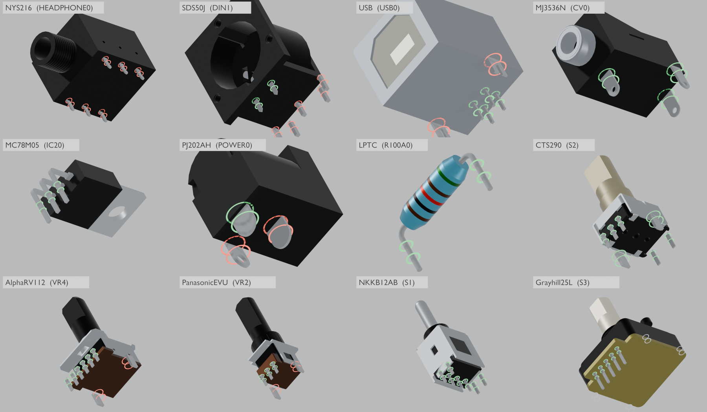

# x0xb0x complete enclosure — Blender revision 16

Open `x0xb0x-populated-with-case.blend` with Blender 5.0.0 or later. All populated board geometry and resources are embedded.

This revision brings in KiCad working revision 13, which adds solder terminals from the manufacturer drawings to the 12 component models that had none: 25 placed references. Every fitted component now has a lead in every drilled hole, except the four Grayhill bracket holes; the drawing does not define those legs.

Each model is drawn from below its seat with the footprint's real drill circles on both board faces:

- **Green** rings fit.
- **Red** rings mark the nominal interferences recorded in [the KiCad review](../../validation/models-review-13/README.md). For example, the NYS216 rows sit 0.35 mm from the footprint rows, PJ-202AH has a 3.0 mm blade in a 2.8 mm hole, and the Alpha and Panasonic bracket tabs fall outside their holes.
- **Grey** rings are empty by design.

Terminal positions follow the drawings and were not moved to the pads.

Only mesh data changes:

- Each of the 93 part objects of the 25 references receives its exact native KiCad revision-13 tessellation, matched by part name.
- Each of the 14 references of the seven assembly models (encoder, pots, switches, thermistors and regulator) gains one terminal part object beside its named parts.
- Terminals use one added tin material copied from the native export; every body keeps its existing scene material.

All 491 component roots, poses, PCB placement, the case, plate, LEDs, caps, hardware, legends, wiring study, cameras and the four views are preserved. Revision 15's rear-panel datums are retained.

| Frame | View |
| --- | --- |
| 1 | Assembled enclosure |
| 80 | Exploded enclosure and populated boards |
| 120 | Control-side switch inspection, caps intentionally hidden |
| 160 | Illustrative wiring study |

The terminals are not visible in the assembled and rear renders; those match revision 15 within render noise. `io-terminals-detail.png` shows the rear connector leads from below through the I/O solder side.

The [saved-scene audit](verification/final-saved-scene-audit.json) reopens revisions 15 and 16 and compares complete object, data and material snapshots and evaluated instances across all four views. The [KiCad comparison](verification/kicad-blender-models-audit.json) matches all 491 placed models exactly. The [aperture check](verification/rear-openings-audit.json) passes 44 checks using 974 rays, and the shared [portability check](verification/portable-scene-audit.json) passes 106 checks. The [validation summary](verification/independent-validation-summary.json) collects the evidence and limits.

Terminal thicknesses, bends and several widths are labelled assumptions, and the LPTC leads have no manufacturer data at all. Grayhill bracket legs and SDS-50J locating pegs remain omitted. These checks do not establish physical fit or fabrication readiness.
