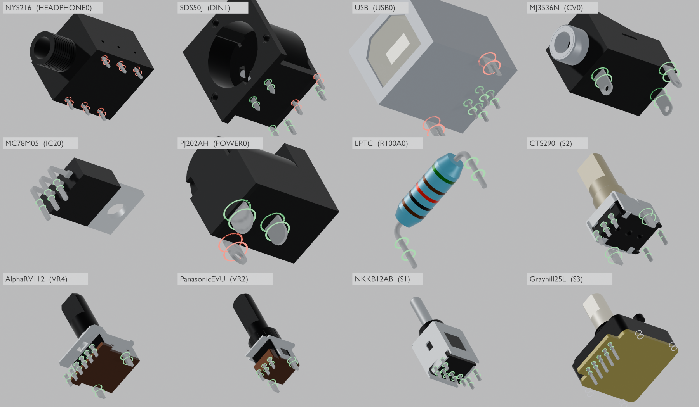

# x0xb0x complete enclosure — Blender revision 17

Open `x0xb0x-populated-with-case.blend` with Blender 5.0.0 or later. All populated board geometry and resources are embedded.

This revision brings in KiCad working revision 14, which corrects four terminal models against their drawings at 12 placed references:

- The Alpha and Panasonic potentiometer snap-in tabs move to their slot centres (±5.5 and ±4.50 mm). The drawings' 13.0 and 10.60 mm dimensions run across the outer slot edges; revision 16 had read them as centre spacing.
- PJ-202AH terminal 2 is the 2.50 mm blade.
- The SDS-50J pins follow the period CUI drawing (rev D, 2006): 0.5 × 1.0 mm signal pins and 1.0 mm earth legs.

The nominal hole audit now records 11 interferences instead of 19. Red rings remain at:

- the NYS216 rows, 0.35 mm from the footprint rows, which is unresolved;
- the USB board-lock forks, a designed press fit in Eagle's undersized holes;
- PJ-202AH terminal 3;
- SDS-50J pins 1 and 2, at Eagle's grid positions.

Neither drawings nor footprints were altered to fit. See [the KiCad review](../../validation/models-review-14/README.md).

Only 12 mesh datablocks change: the SDS-50J and PJ-202AH connector meshes and the terminal part objects of the seven potentiometers. Their body tessellations matched the native export byte for byte. Every object, pose, material, the case, LEDs, caps, hardware, legends, wiring study, cameras and the four views are preserved from revision 16. The assembled and rear renders are pixel-identical to revision 16.

| Frame | View |
| --- | --- |
| 1 | Assembled enclosure |
| 80 | Exploded enclosure and populated boards |
| 120 | Control-side switch inspection, caps intentionally hidden |
| 160 | Illustrative wiring study |

The [saved-scene audit](verification/final-saved-scene-audit.json) reopens revisions 16 and 17 and compares complete snapshots across all four views. The [KiCad comparison](verification/kicad-blender-models-audit.json) matches all 491 placed models exactly. The [aperture check](verification/rear-openings-audit.json) passes 44 checks using 974 rays, and the [portability check](verification/portable-scene-audit.json) passes 106 checks. The [validation summary](verification/independent-validation-summary.json) collects the evidence and limits.

Terminal thicknesses, bends and several widths remain labelled assumptions; the LPTC leads have no manufacturer data. These checks do not establish physical fit or fabrication readiness.
