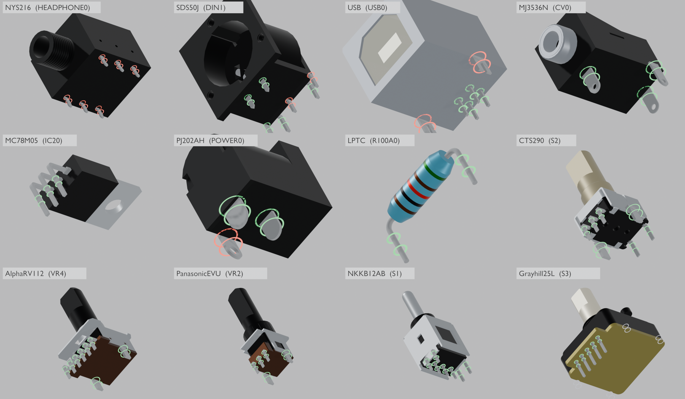

# x0xb0x complete enclosure — Blender revision 18

Open `x0xb0x-populated-with-case.blend` with Blender 5.0.0 or later. All populated board geometry and resources are embedded.

This revision brings in KiCad working revision 15. Every drawing-derived terminal now joins its component body. In revisions 16 and 17, 24 terminals of six models stopped just above the seat beside the body: the Alpha and Panasonic pot pins, the CTS encoder terminals, the NKK bracket legs, SDS-50J pins 4–5, and the MJ-3536N tip and shunt. Each now has a formed leg with its own section, running from the pin into the nearest body edge, as the drawings show these terminals leaving the base and turning down. Leg height and bend are assumptions. Pin positions, holes and the 11 recorded nominal interferences are unchanged.

Only 15 mesh datablocks change: the terminal parts at the 15 corrected references. Body tessellations matched the native export byte for byte. Every object, pose, material, the case, LEDs, caps, hardware, legends, wiring study, cameras and the four views are preserved from revision 17. The assembled, rear and exploded renders are identical within render noise.

| Frame | View |
| --- | --- |
| 1 | Assembled enclosure |
| 80 | Exploded enclosure and populated boards |
| 120 | Control-side switch inspection, caps intentionally hidden |
| 160 | Illustrative wiring study |

The [saved-scene audit](verification/final-saved-scene-audit.json) reopens revisions 17 and 18 and compares complete snapshots across all four views. The [terminal join check](verification/terminal-join-audit.json) finds all 133 placed terminal pieces joined to their bodies. The [KiCad comparison](verification/kicad-blender-models-audit.json) matches all 491 placed models exactly. The [aperture check](verification/rear-openings-audit.json) passes 44 checks using 974 rays, and the [portability check](verification/portable-scene-audit.json) passes 106 checks. The [validation summary](verification/independent-validation-summary.json) collects the evidence and limits.

These checks do not establish physical fit or fabrication readiness.
