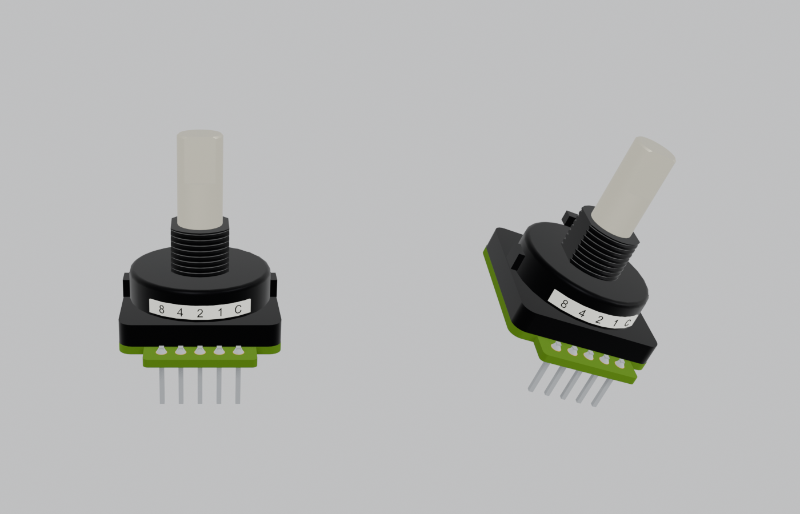

# x0xb0x complete enclosure — Blender revision 19

Open `x0xb0x-populated-with-case.blend` with Blender 5.0.0 or later. All populated board geometry and resources are embedded.

This revision brings in KiCad working revision 16: the two Grayhill 25L rotary switches (S3, S4) rebuilt from the Series 25L drawing and a product photograph of the hex-output part.

- **From the photograph:** a square base with a round drum top and two lock lugs, the white `8 4 2 1 C` label band, and a green output board with gold lands and solder joints.
- **From the drawing:** the non-turn tab now sits on the centre line opposite the pins, where the drawing's front view puts it.

Printed dimensions, the shaft, bushing and pin positions are unchanged. The four MT holes stay empty because the BOM part has no bracket.

Per switch, six existing part objects receive new native meshes, the old land-illustration part is removed, and four parts are added: lands, solder joints, label band and label text. Five materials are added for the new colours. The two old materials that only the Grayhill board and lands used are no longer present. Every other object, pose, material, the case, LEDs, caps, hardware, legends, wiring study, cameras and the four views are preserved from revision 18. The assembled, rear and exploded renders are pixel-identical within render noise.

| Frame | View |
| --- | --- |
| 1 | Assembled enclosure |
| 80 | Exploded enclosure and populated boards |
| 120 | Control-side switch inspection, caps intentionally hidden |
| 160 | Illustrative wiring study |

The [saved-scene audit](verification/final-saved-scene-audit.json) reopens revisions 18 and 19 and allows only the declared Grayhill objects and materials. The [KiCad comparison](verification/kicad-blender-models-audit.json) matches all 491 placed models exactly. The [terminal join check](verification/terminal-join-audit.json) finds all 133 terminal pieces joined. The [aperture check](verification/rear-openings-audit.json) passes 44 checks using 974 rays, and the [portability check](verification/portable-scene-audit.json) passes 106 checks. The [validation summary](verification/independent-validation-summary.json) collects the evidence and limits.

The drum, lug and label proportions are photo-derived. The photograph is not retained, and its period is not recorded. These checks do not establish physical fit or fabrication readiness.
