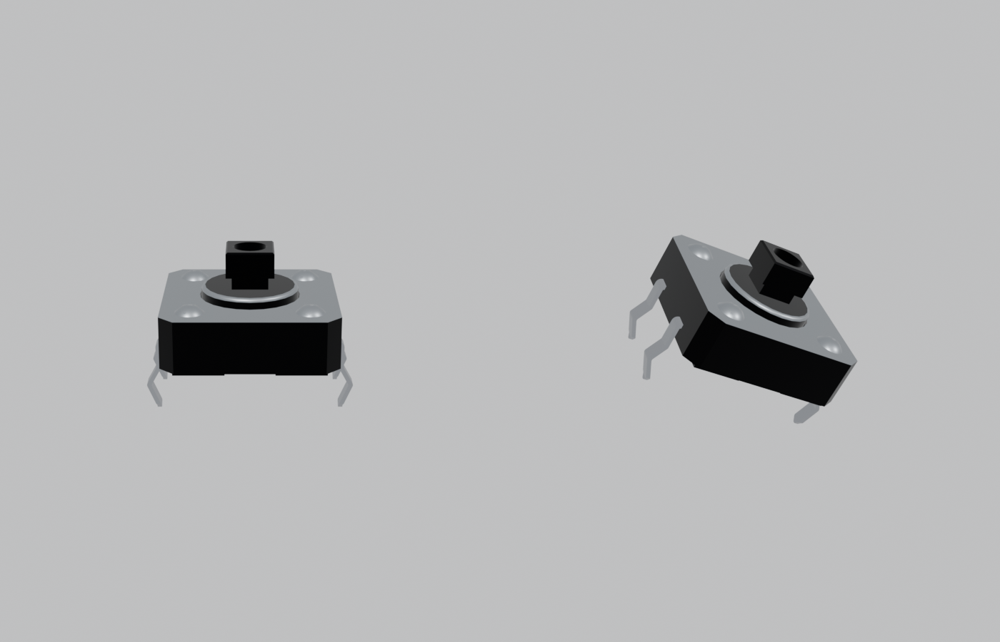

# x0xb0x complete enclosure — Blender revision 20

Open `x0xb0x-populated-with-case.blend` with Blender 5.0.0 or later. All populated board geometry and resources are embedded.

This revision brings in KiCad working revision 17: the 23 TL1100F tact switches (S5–S27) show metal legs. Revision 8 coloured the publisher CAD's faces by position and left black the 24 faces per switch where the legs leave the housing and rise above the board. Those faces are now terminal metal. The geometry is unchanged.

Only the 23 switch mesh datablocks change, and they reuse the switch's existing four materials. Every object, pose, material, the case, LEDs, caps, hardware, legends, wiring study, cameras and the four views are preserved from revision 19. The assembled and rear renders are unchanged; the legs show in the control-side view.

| Frame | View |
| --- | --- |
| 1 | Assembled enclosure |
| 80 | Exploded enclosure and populated boards |
| 120 | Control-side switch inspection, caps intentionally hidden |
| 160 | Illustrative wiring study |

The [saved-scene audit](verification/final-saved-scene-audit.json) reopens revisions 19 and 20 and allows only the 23 declared meshes. The [KiCad comparison](verification/kicad-blender-models-audit.json) matches all 491 placed models exactly. The comparison measures geometry, so the colours are checked separately by the native colour check in `validation/models-review-17`. The [terminal join check](verification/terminal-join-audit.json), the [aperture check](verification/rear-openings-audit.json) (44 checks, 974 rays) and the [portability check](verification/portable-scene-audit.json) (106 checks) pass. The [validation summary](verification/independent-validation-summary.json) collects the evidence.

These checks do not establish physical fit or fabrication readiness.
